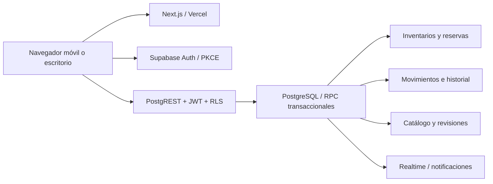

# Arquitectura

## Decisiones

Next.js App Router sirve la aplicación React y sus recursos. La bienvenida es prerenderizable. La zona autenticada utiliza el SDK de Supabase; todas las operaciones sensibles terminan en funciones PostgreSQL con comprobaciones de identidad y permisos. No hay un servidor adicional ni claves administrativas en el frontend.

Esta elección mantiene un único origen de verdad para reservas e inventarios. La seguridad no depende de ocultar botones ni de las URLs. Las funciones de escritura identifican a la persona por `auth.uid()`, nunca por un usuario elegido por el cliente.

## Código

| Directorio                    | Responsabilidad                                                 |
| ----------------------------- | --------------------------------------------------------------- |
| `src/app`                     | Punto de entrada, metadatos, estados de carga/error y estilos   |
| `src/components/landing.tsx`  | Bienvenida pública                                              |
| `src/components/cromatch.tsx` | Estado de la sesión y vistas de colección/comunidad             |
| `src/components/ui.tsx`       | Marca, vacíos y texto provisional de privacidad                 |
| `src/components/dialog.tsx`   | Foco del diálogo, Escape y retorno de foco                      |
| `src/lib/domain.ts`           | Repetidos, coincidencias, estadísticas y esquema del importador |
| `src/lib/supabase.ts`         | Cliente público de Supabase y exportación                       |
| `supabase/migrations`         | Esquema, autorización y operaciones transaccionales             |
| `tests`                       | Dominio, RLS, intercambio y concurrencia                        |
| `tests/e2e`                   | Flujos públicos en navegador                                    |

La zona autenticada agrupa sus vistas en un controlador de estado. Una ampliación posterior puede dividirlo por funcionalidad y rutas sin cambiar los contratos de base de datos. Los borradores viven únicamente en la sesión actual, no se presentan como guardados en el servidor.

## Navegación

La barra inferior móvil contiene Inicio, Mi álbum, Intercambios, Amigos y Perfil. En escritorio se presenta en una barra lateral. Desde el álbum se accede a todos los cromos, repetidos, faltantes y captura manual. Inicio enlaza estadísticas y notificaciones. Perfil agrupa privacidad, exportación, eliminación, enlaces y administración autorizada.

Las vistas se seleccionan dentro de `/`; el hash refleja la sección actual, pero no constituye una autorización ni una ruta de servidor. El detalle de cromo y los textos de privacidad se abren como diálogos con control de foco.

## Modelo de datos

| Tablas                                                 | Propósito e integridad                                                                                                                                              |
| ------------------------------------------------------ | ------------------------------------------------------------------------------------------------------------------------------------------------------------------- |
| `profiles`, `user_privacy_settings`                    | Nombre de usuario único y privacidad independiente. Sin correo público. Perfil separado de Auth para conservar referencias seudonimizadas tras eliminar una cuenta. |
| `collections`, `teams`, `sticker_series`               | Colecciones y temporadas ampliables; agrupación por equipo y serie.                                                                                                 |
| `stickers`                                             | UUID estable; unicidad por colección, código, edición y variante. Posición física opcional e independiente.                                                         |
| `sticker_catalog_revisions`                            | Fotografías JSON antes/después de cada importación. No permite editar el pasado.                                                                                    |
| `user_collections`, `user_inventory`                   | Una fila por usuario/cromo. La colección se deduce de la FK del cromo, evitando una segunda referencia inconsistente.                                               |
| `inventory_operations`                                 | IDs de operación para reintentos idempotentes del contador.                                                                                                         |
| `friendships`, `user_blocks`                           | Amistad con par único y bloqueo bilateral para acceso.                                                                                                              |
| `trade_proposals`, `trade_participants`, `trade_items` | Propuesta, participantes, confirmaciones y unidades exactas. El modelo de participantes admite ampliación; el RPC inicial solo admite dos personas.                 |
| `trade_reservations`                                   | Compromisos aceptados sin modificar las unidades poseídas.                                                                                                          |
| `inventory_transactions`                               | Movimientos append-only de edición manual e intercambios.                                                                                                           |
| `notifications`                                        | Novedades internas de cada cuenta.                                                                                                                                  |
| `shared_lists`                                         | Lista acotada, token aleatorio, caducidad y revocación; acceso solo para registrados.                                                                               |
| `reports`, `audit_logs`, `rate_limits`                 | Denuncias, auditoría y límites por cuenta/minuto.                                                                                                                   |

El esquema completo, con tipos, FK, restricciones e índices, está en la migración. Las filas con cantidad cero se conservan; los faltantes se obtienen del catálogo publicado, no de la existencia de una fila de inventario.

## Contratos principales

- `change_quantity(sticker, delta, operation)`: incrementos ±1, propietario derivado del JWT, control de reservas, límite e idempotencia.
- `find_matches(collection)`: compara amigos autorizados por ID de cromo y ordena por utilidad recíproca; no equipara rarezas.
- `propose_trade(receiver, collection, items, id)`: unidades seleccionadas a mano, sin exigir igual número por parte. La amistad y visibilidad son obligatorias.
- `trade_action(trade, action)`: aceptar, rechazar, cancelar o confirmar, con verificación de participantes y estados.
- `import_catalog(collection, rows)`: validación de privilegios, estabilidad de IDs y revisión antes/después.

## Concurrencia

Todos los cambios de cantidades toman un bloqueo asesor transaccional por usuario. Una operación con dos usuarios adquiere ambos bloqueos en orden determinista. El estado de cada intercambio se bloquea con `FOR UPDATE`. La aceptación revalida y reserva todas las unidades o revierte toda la operación.

La primera confirmación guarda la aceptación de entrega del participante. La segunda libera las reservas, descuenta y añade unidades en ambos inventarios, registra los movimientos y finaliza la propuesta en una sola transacción. La repetición de una confirmación finalizada no vuelve a mover cromos.

Una cancelación libera las reservas y no crea movimientos de posesión. Los intercambios completados no se pueden editar desde el cliente. Los RPC comprueban el acceso aunque se invoquen directamente.

## Rendimiento y límites actuales

Se indexan propietario/cromo, colección/código, amistades, intercambios y notificaciones. La búsqueda de usuarios es por prefijo normalizado. Los resultados de coincidencias se calculan en servidor. El catálogo se descarga por bloques y la cuadrícula muestra páginas de 48 elementos. La primera versión mantiene en memoria la colección actual y el inventario propio; no está demostrada aún su capacidad para miles de usuarios. Para grandes catálogos se debe trasladar también el filtrado y los agregados al servidor.

Realtime notifica cambios del propietario; al recuperar foco y cada 30 segundos se consulta de nuevo la base como respaldo. La PWA no guarda datos privados en caché ni encola escrituras desconectadas: debe informar del fallo y permitir reintentar con el mismo ID de operación.
